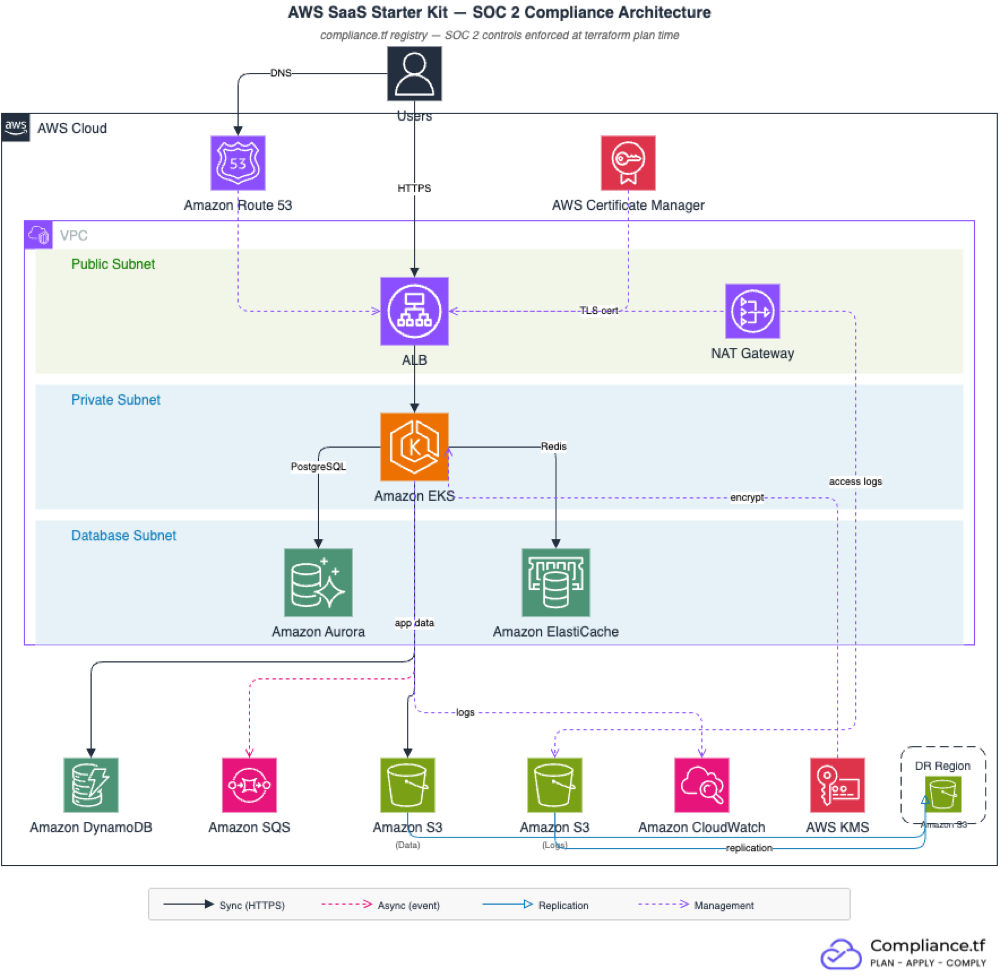

# B2B SaaS Starter Kit - SOC 2

Pre-composed Terraform configuration that deploys SOC 2-compliant AWS infrastructure for B2B SaaS companies. All modules are sourced from the [compliance.tf](https://compliance.tf) registry, which enforces SOC 2 controls at `terraform plan` time.

## Architecture



## Prerequisites

- Terraform >= 1.3
- AWS credentials configured (`aws configure` or environment variables)
- A compliance.tf access token ([sign up](https://compliance.tf) or [start a free trial](https://compliance.tf/free-trial/))
- A Route 53 hosted zone for your domain (used for ACM DNS validation)
- **S3 cross-region replication resources** (SOC 2 A1.2 requires data durability):
  - An IAM role ARN authorized for S3 replication (`s3_replication_role_arn`)
  - A destination S3 bucket in your DR region (`s3_replication_destination_bucket_arn`)

  Set these up before running `terraform apply`. See the [AWS documentation on setting up replication](https://docs.aws.amazon.com/AmazonS3/latest/userguide/replication.html) for details.

## Quick Start

```bash
# 1. Clone the repo
git clone https://github.com/compliancetf/starter-kit-saas-soc2.git
cd starter-kit-saas-soc2

# 2. Copy the example tfvars and fill in your values
cp terraform.tfvars.example terraform.tfvars
# Edit terraform.tfvars  - set at minimum:
#   project_name, domain_name, route53_zone_id,
#   availability_zones (must match aws_region),
#   s3_replication_role_arn, s3_replication_destination_bucket_arn

# 3. Authenticate with the compliance.tf registry
terraform login soc2.compliance.tf

# 4. Initialize, plan, and apply
terraform init
terraform plan
terraform apply
```

`terraform plan` will fail if any required SOC 2 controls are not satisfied. Fix the reported issues and re-run the plan. With the default configuration, a successful plan creates approximately 107 resources.

## Module Inventory

| Module | Source | Version | Purpose | Key SOC 2 Controls |
|--------|--------|---------|---------|---------------------|
| `vpc` | `soc2.compliance.tf/terraform-aws-modules/vpc/aws` | `~> 6.0` | Network isolation, flow logs, database subnets | CC6.1 (access boundaries), CC7.1 (flow log monitoring) |
| `alb` | `soc2.compliance.tf/terraform-aws-modules/alb/aws` | `~> 10.0` | HTTPS load balancing, access logs | CC6.6 (TLS 1.3), CC6.7 (HTTPS enforced) |
| `waf` | `soc2.compliance.tf/terraform-aws-modules/wafv2/aws` | `~> 1.0` | Web Application Firewall (AWS managed rules, ALB association) | CC6.6 (OWASP Top 10, IP reputation) |
| `acm` | `soc2.compliance.tf/terraform-aws-modules/acm/aws` | `~> 6.0` | TLS certificate (DNS-validated) | CC6.7 (encryption in transit) |
| `kms` | `soc2.compliance.tf/terraform-aws-modules/kms/aws` | `~> 4.0` | Encryption key for EKS CloudWatch logs | CC6.1 (customer-managed encryption keys) |
| `eks` | `soc2.compliance.tf/terraform-aws-modules/eks/aws` | `~> 21.0` | Kubernetes cluster (private subnets, KMS-encrypted logs) | CC6.1 (secrets encryption), CC7.1 (log exports) |
| `rds_aurora` | `soc2.compliance.tf/terraform-aws-modules/rds-aurora/aws` | `~> 10.0` | Aurora PostgreSQL (Multi-AZ, encrypted) | CC6.1 (encryption, IAM auth), A1.2 (failover, backups) |
| `s3_bucket_data` | `soc2.compliance.tf/terraform-aws-modules/s3-bucket/aws` | `~> 5.0` | Application data with cross-region replication | CC6.1 (encryption, no public access), CC7.2 (versioning), A1.2 (cross-region replication) |
| `s3_bucket_logs` | `soc2.compliance.tf/terraform-aws-modules/s3-bucket/aws` | `~> 5.0` | Centralized access logs (ALB + S3) with cross-region replication | CC7.1 (log retention), CC8.1 (audit trail), A1.2 (cross-region replication) |
| `dynamodb` | `soc2.compliance.tf/terraform-aws-modules/dynamodb-table/aws` | `~> 5.0` | Key-value store with PITR | CC6.1 (encryption), A1.2 (point-in-time recovery) |
| `elasticache` | `soc2.compliance.tf/terraform-aws-modules/elasticache/aws` | `~> 1.0` | Redis cache (encrypted, auth) | CC6.1 (encryption at rest + transit), A1.2 (failover) |
| `sqs` | `soc2.compliance.tf/terraform-aws-modules/sqs/aws` | `~> 5.0` | Message queue with DLQ | CC6.1 (SSE encryption), CC7.2 (dead-letter queue) |
| `cloudwatch` | `soc2.compliance.tf/terraform-aws-modules/cloudwatch/aws` | `~> 5.0` | Application log group | CC7.1 (centralized logging), CC7.2 (retention policy) |

## SOC 2 Control Coverage

| SOC 2 Criterion | Description | Module(s) | What's Enforced |
|-----------------|-------------|-----------|-----------------|
| CC6.1 | Logical access security | KMS, RDS Aurora, S3, EKS, ElastiCache, DynamoDB, SQS | Encryption at rest, customer-managed keys, no public access, IAM authentication |
| CC6.6 | Measures against external threats | ALB, WAF | TLS 1.2+ (TLS 1.3 policy), security groups restricted to HTTPS, WAF with AWS managed rules (OWASP Top 10, known bad inputs, IP reputation) |
| CC6.7 | Restrict data transmission | ALB, ElastiCache | HTTPS-only listeners, transit encryption enabled |
| CC7.1 | Detection and monitoring | VPC, ALB, RDS Aurora, CloudWatch, S3 (logs) | VPC flow logs, ALB access logs, PostgreSQL log exports, CloudWatch log groups |
| CC7.2 | Anomaly detection | S3, SQS, CloudWatch | S3 versioning, dead-letter queues, log retention policies |
| CC8.1 | Change management | All modules | Infrastructure changes tracked in Terraform state and version control, deletion protection (prod) |
| A1.2 | Environmental protections | RDS Aurora, ElastiCache, S3 (data + logs) | Multi-AZ deployment, automatic failover, automated backups (7-14 days), S3 cross-region replication |

## What compliance.tf Covers vs. What You Own

### compliance.tf handles (infrastructure controls)

- Encryption at rest and in transit for all data stores (customer-managed KMS keys for EKS logs)
- S3 cross-region replication for data durability and disaster recovery
- Network isolation (private subnets, database subnets, security groups, no public DB access)
- TLS 1.2+ enforcement on all external endpoints
- Access logging and log retention
- Multi-AZ and automated backups
- Deletion protection in production
- Validation at `terraform plan` - non-compliant configurations fail before deployment

### You are responsible for (application and organizational controls)

- Application-level authentication and authorization
- Identity provider configuration and MFA
- HR policies (background checks, security training)
- Vendor management and third-party risk assessments
- Incident response procedures
- Business continuity and disaster recovery planning
- Access reviews and user lifecycle management
- Application-level audit logging (business events)

compliance.tf does not replace your SOC 2 auditor. It ensures your AWS infrastructure meets the technical control requirements so you can focus on the organizational controls that auditors also evaluate.

## Cost Estimate

Approximate monthly cost for the default configuration. Actual costs depend on usage, data transfer, and region.

| Component | Dev | Prod | Notes |
|-----------|-----|------|-------|
| VPC + NAT Gateway | ~$35 | ~$100 | Single NAT (dev) vs. per-AZ NAT (prod) |
| ALB | ~$25 | ~$25+ | Plus LCU charges based on traffic |
| EKS | ~$75 | ~$75 | Control plane; node costs below |
| EKS Nodes (t3.medium) | ~$60 | ~$120+ | 2 nodes (dev) vs. 2-6 nodes (prod) |
| Aurora PostgreSQL (db.r6g.large) | ~$200 | ~$400 | 1 instance (dev) vs. writer + reader (prod) |
| S3 (data + logs) | ~$5 | ~$5+ | Scales with storage and requests |
| DynamoDB (on-demand) | ~$0 | ~$0+ | Pay per request; no base cost |
| ElastiCache (cache.t4g.micro) | ~$10 | ~$20 | 1 node (dev) vs. 2 nodes with failover (prod) |
| SQS | ~$0 | ~$0+ | Free tier covers most dev usage |
| CloudWatch Logs | ~$5 | ~$10+ | Scales with log volume |
| WAF | ~$5 | ~$5+ | $5/month per WebACL + $1/rule + per-request charges |
| KMS | ~$1 | ~$1+ | $1/month per key plus API call charges |
| **Total (order of magnitude)** | **~$500-800** | **~$1,500-2,500** | |

These are rough estimates. Run `terraform plan` and use the [AWS Pricing Calculator](https://calculator.aws/) for your specific configuration. Tools like [Infracost](https://www.infracost.io/) can estimate costs directly from your Terraform code.

## Customization

### Swap EKS for ECS

Remove the `eks` module block in `main.tf` and replace it with:

```tf
module "ecs" {
  source  = "soc2.compliance.tf/terraform-aws-modules/ecs/aws"
  version = "~> 5.0"

  cluster_name = local.name

  fargate_capacity_providers = {
    FARGATE = {
      default_capacity_provider_strategy = {
        weight = 100
      }
    }
  }

  tags = var.tags
}
```

Update the ALB target group to point to your ECS service instead of EKS pods.

### Add a second region (disaster recovery)

S3 cross-region replication is already configured for both the data and logs buckets via the `s3_replication_role_arn` and `s3_replication_destination_bucket_arn` variables. To extend DR to compute and database layers, duplicate the configuration into a second directory with a separate provider alias:

```tf
provider "aws" {
  alias  = "dr"
  region = "us-west-2"
}
```

Use Aurora Global Database for database replication. Each region needs its own VPC and compute resources.

### Remove DynamoDB

If your application does not need a key-value store, delete the `dynamodb` module block from `main.tf` and remove the corresponding outputs from `outputs.tf` and variables from `variables.tf`.

### Adjust instance sizes

All instance sizes are controlled via variables. Override them in `terraform.tfvars`:

```hcl
# Larger EKS nodes for heavier workloads
eks_node_instance_types = ["m6i.xlarge"]
eks_node_min_size       = 3
eks_node_max_size       = 10

# Larger Aurora instances
aurora_instance_class = "db.r6g.xlarge"

# Larger Redis nodes
redis_node_type = "cache.r6g.large"
```

### Disable a specific control

If a SOC 2 control does not apply to your use case, disable it with a query parameter on the module source:

```tf
module "s3_bucket_data" {
  source  = "soc2.compliance.tf/terraform-aws-modules/s3-bucket/aws?disable=s3_bucket_object_lock_enabled"
  version = "~> 5.0"
  # ...
}
```

## Other Starter Kits

| Kit | Frameworks | Use Case |
|-----|-----------|---------|
| [Fintech - PCI DSS v4.0 + SOC 2](https://github.com/compliancetf/starter-kit-fintech-pcidss) | PCI DSS v4.0, SOC 2 | Payment platforms, neobanks, BNPL |
| [HealthTech - HIPAA + SOC 2](https://github.com/compliancetf/starter-kit-healthtech-hipaa) | HIPAA, SOC 2 | Telehealth, EHR, health data platforms |

## Links

- [compliance.tf docs](https://compliance.tf/docs/)
- [Migration guide](https://compliance.tf/docs/guides/migration/) - migrate existing terraform-aws-modules to compliance.tf
- [Version compatibility matrix](https://compliance.tf/docs/guides/migration/version-compatibility/) - supported module versions
- [Controls reference](https://compliance.tf/docs/controls/) - full list of enforced controls per framework

## License

Apache 2.0. See [LICENSE](LICENSE).
